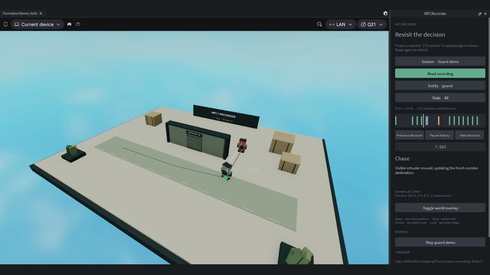

# NPCRecorder

Revisit an NPC's decisions with the context your code actually recorded.



[Watch the Studio demo](https://github.com/Ggaming5005/NPCRecorder/releases/download/v0.1.0/NPCRecorder-demo.mp4).

Add small hooks to your existing NPC system, then inspect a bounded history of state, reason, position, target and route points in Studio. Scrub the timeline, jump between decisions, filter an entity or state, and see the recorded position and path in the world.

NPCRecorder observes explicit hooks. It does not infer intent, control your NPCs, record the entire game, or rewind the simulation.

## Downloads and installation

| File | Purpose |
| --- | --- |
| `NPCRecorder.rbxm` | Runtime ModuleScript for your server-side instrumentation |
| `NPCRecorderStudio.rbxm` | Studio inspector plugin |
| `NPCRecorderDemo.rbxlx` | Standalone guard example |
| `NPCRecorder-demo.mp4` | Demonstration |

Download from [Releases](https://github.com/Ggaming5005/NPCRecorder/releases). Insert the runtime ModuleScript into `ServerStorage` and name it `NPCRecorder`. Install the separate plugin by inserting its model into a temporary place, selecting the inserted Script, and choosing **Save as Local Plugin**. Delete that inserted copy afterward. Open **Plugins → NPCRecorder**.

The inspector includes an editor guard example. The standalone place starts its example on the server during Play. See [the example notes](docs/demo.md) for its actual sight and movement rules.

## Add recording hooks

Use this from the server system that owns your NPCs. `guard` must be an existing, parented Model or BasePart.

```luau
local Recorder = require(game.ServerStorage.NPCRecorder)

local recording = Recorder.new({
    Name = "Warehouse guards",
    Capacity = 300,
    Window = 60,
    SampleInterval = 0.15,
    PublishInterval = 1,
})

recording:Track("guard-01", guard)
recording:Start()

-- Call when your existing NPC code chooses this action.
recording:Record("guard-01", "Chase", "Target visible within detection range", {
    Target = targetPosition,
    Path = { guard:GetPivot().Position, nextWaypoint },
})

-- Finish explicitly when the owning system ends.
recording:Destroy()
```

`Target` is an optional Vector3. `Path` is an optional dense array of up to 24 Vector3 positions. For a Roblox Path, pass waypoint positions yourself; the recorder does not invoke PathfindingService. Reasons should explain the branch your own code selected.

Recording is enabled only in Studio's editor/server contexts. Track, Record, Start and Capture are inert on a Play Client or outside Studio. There are no RemoteEvents, uploads, HTTP calls or package dependencies.

## Inspect a trace

1. Play your instrumented game and switch Studio to the **Server** test view.
2. Open NPCRecorder. Click the session control to refresh/cycle available recordings, then **Read recording**.
3. Choose the entity and state filter. Click or drag the timeline, enter a time, or use the previous/next decision buttons.
4. Toggle the world overlay as needed. Green marks recorded position, blue the recent trail, amber the supplied route, and coral the supplied target.
5. Read again for a newer snapshot. The loaded history is deliberately frozen while you inspect it.

**Copy JSON before stopping Play if you want to keep a recording.** Choose **Show recording JSON**, focus the text box and copy its text somewhere you control. After Play ends, use **Paste / import JSON** to inspect it again. No recording is automatically written to disk or retained across Studio sessions. Imported positions overlay the current place; keep the same scene and coordinates for a meaningful comparison.

Closing the panel stops history playback, clears its overlay and stops a plugin-owned demo. It does not stop an independently instrumented recorder in your game. Unloading destroys plugin resources.

## API and ownership

| Method | Behavior |
| --- | --- |
| `Track(id, model)` | Registers a parented Model/BasePart and its initial state; duplicate tracked IDs fail |
| `Record(id, state, reason, details?)` | Appends a decision and updates the context attached to subsequent position samples |
| `Start()` / `Stop()` | Starts/stops automatic sampling and snapshot publication; both are idempotent |
| `Snapshot()` | Returns an immutable value snapshot of retained history |
| `Capture()` | Publishes the latest JSON in a private ServerStorage session and returns its snapshot |
| `Untrack(id)` | Stops future sampling and disconnects that model's lifecycle listener; retained history remains |
| `Clear()` | Discards history, resets time, and records the current context of still-tracked entities |
| `Destroy()` | Disconnects all recorder signals and destroys its private session/history; idempotent |

Model destruction automatically untracks it. Destroy the recorder when your NPC manager ends; deleting the script that created it is not a cleanup mechanism. If automatic sampling/publication fails, the recorder stops its loop and exposes `LastError` rather than repeatedly failing each frame.

## Bounds and interpretation

- Up to eight distinct entity IDs between history clears. Untracking an ID preserves its historical budget until Clear.
- `Capacity`: 1–512 events **per entity**, default 300. Decisions and position samples share this capacity.
- `Window`: 1–600 seconds, default 60. This is an upper age limit; capacity can shorten the retained interval.
- `SampleInterval`: 0.05–5 seconds, default 0.15. `PublishInterval`: 0.5–30 seconds, default 1.
- IDs: 1–64 bytes; states: 1–48 bytes; reasons: 1–256 bytes. Coordinates must be finite and within ±10,000,000 studs.
- Imported JSON and published snapshots are limited to 2 MiB, and imports to 4,096 events. Long paths may require lower capacity. A publication-size failure leaves the previous published snapshot and stops automatic recording with LastError.

The displayed state is the latest retained event at or before the chosen time. Position samples carry the last explicitly supplied state/reason/target/path. The overlay does not reconstruct collisions, animation, unrecorded variables, AI logic or historical scene geometry. The `dropped` count records capacity/age evictions made while appending; expired idle history filtered from a snapshot is not added to that count.

## Development

Build with Rojo 7.7.0 and use Luau 0.747 for portable checks:

```sh
luau tests/run.luau
luau-analyze src/Core.luau
rojo build default.project.json -o NPCRecorder.rbxm
rojo build plugin.project.json -o NPCRecorderStudio.rbxm
rojo build demo.project.json -o NPCRecorderDemo.rbxlx
```

The runtime, inspector and demo assets are separate outputs. Read [research](docs/research.md) and [verification](docs/verification.md) for the design references and precise coverage.

Original source and example assets, MIT licensed. Built by [Ggaming5005](https://github.com/Ggaming5005).
